<div align="center">

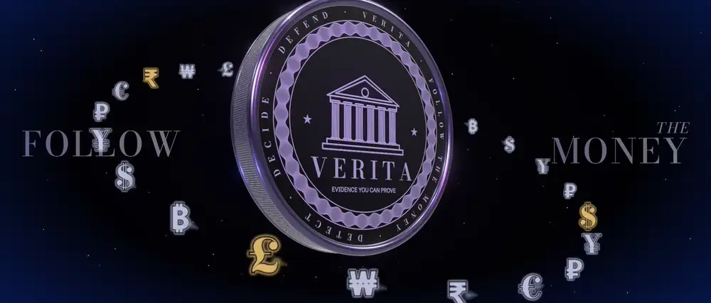

# V E R I T A

### *Evidence you can prove.*

**An anti-money-laundering system that finds the laundering, promises how much it will catch,<br>
and signs every report so nobody — not even its author — can quietly change it.**

[](https://github.com/rajmodi262/verita-v2/actions/workflows/ci.yml)


[](LICENSE)

**[▶ Watch the pitch](#-see-it-in-3-minutes)** · **[What's new](#-four-ideas-in-plain-words)** · **[Results](#-results)** · **[One payment, end to end](#-follow-one-payment)** · **[Run it](#-run-it)** · **[Defend it](docs/DEFEND_IT.md)**

</div>

---

## 🎬 See it in 3 minutes

<table>
<tr>
<td width="50%"><a href="https://drive.google.com/file/d/1dGf_hMmNGliAk5dcq6TRx1ERwbfGYbmm/view">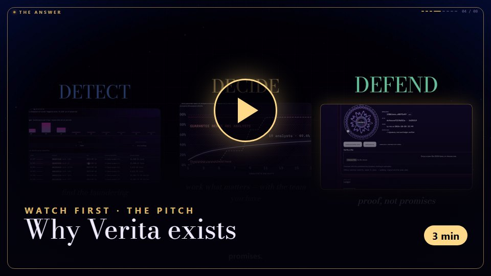</a></td>
<td width="50%"><a href="https://drive.google.com/file/d/1R-3b8Q6HyusixPaMJe7pVZ4cET5YLe7i/view">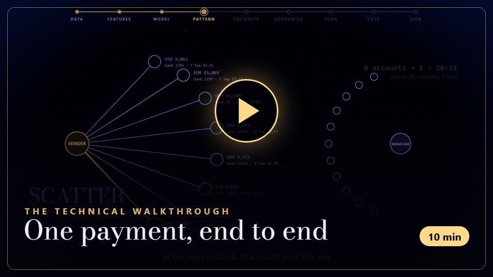</a></td>
</tr>
<tr>
<td align="center"><b>The pitch</b> — the problem, what's new, the solution. <i>For anyone.</i></td>
<td align="center"><b>The walkthrough</b> — every technique, on one real payment. <i>For engineers.</i></td>
</tr>
</table>

---

## 🧭 The problem

Every morning, a bank's compliance analyst opens a queue of **thousands of alerts**. Most are noise.
She has time for a few hundred. Three things are broken:

| | | |
|:---:|---|---|
| 🌫️ | **Noise** | Rules engines flag everything that *looks* odd, so real laundering hides in the pile. |
| 🕳️ | **Blind spots** | When the regulator asks *"what did you miss?"*, nobody can answer with a number. |
| 🤖 | **Untrusted reports** | AI now drafts the reports in seconds — and sometimes invents a number nobody notices. |

Most AML projects stop at a model score. **Verita is about what happens after the score.**

---

## 💡 Four ideas, in plain words

<table>
<tr>
<td width="50%" valign="top">

### 🔍 It sees the *shape* of the money
Criminals split money, scatter it across accounts and gather it back. Verita scores each
payment with **leakage-safe features** (every window ends one minute *before* the payment), names
the **laundering pattern** — fan-in, cycle, scatter-gather… — and explains every alert in plain
English: *"this account is 9 days old and suddenly received $18,000"*, not *"feature 17"*.

</td>
<td width="50%">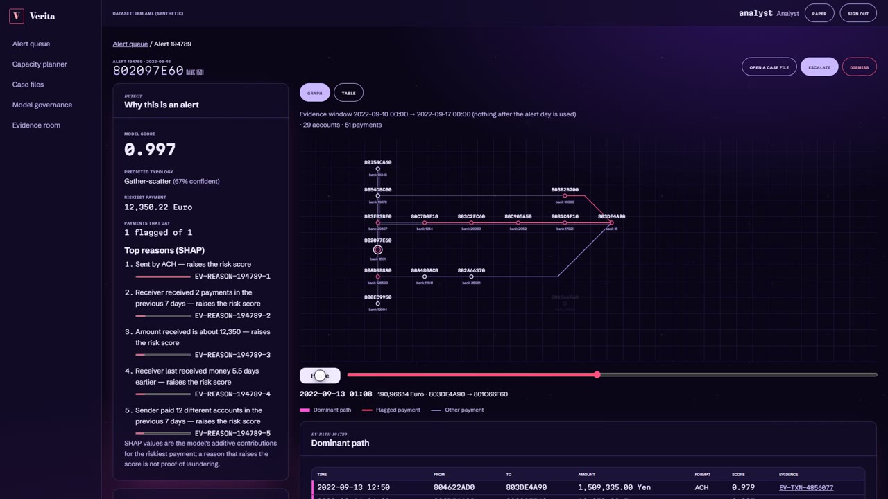</td>
</tr>
<tr>
<td width="50%">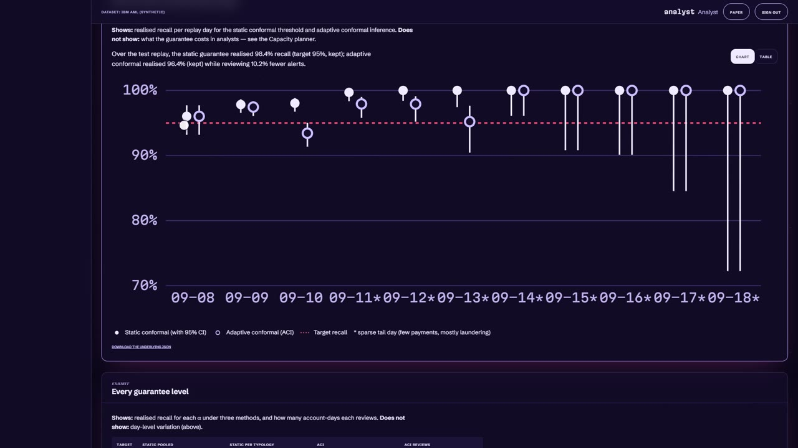</td>
<td width="50%" valign="top">

### 🎣 A fishing net with a promise on it
Most systems give you a score. Verita gives you a **promise**: *"review these and you will catch
at least 95 of every 100 laundering payments"* — a **conformal-prediction guarantee**, set per
laundering pattern, that **adapts when criminals change behaviour**. The chart above checks the
promise day by day on data the model never saw.

</td>
</tr>
<tr>
<td width="50%" valign="top">

### 🧳 Packing the day like a suitcase
Each alert has a risk, a value and a time to investigate. The team has a fixed number of hours.
Verita solves that as a **knapsack** with Google OR-Tools CP-SAT — the alerts the promise needs go
in first, spare time goes where it catches most — and if the team is too small, **it says so, with
a number**.

</td>
<td width="50%">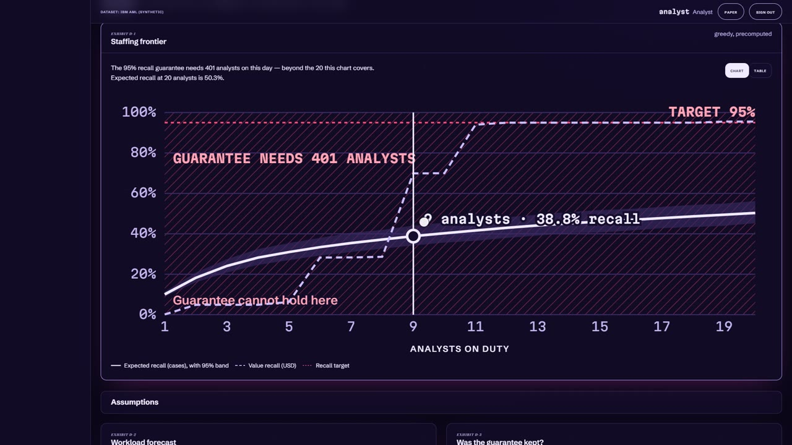</td>
</tr>
<tr>
<td width="50%">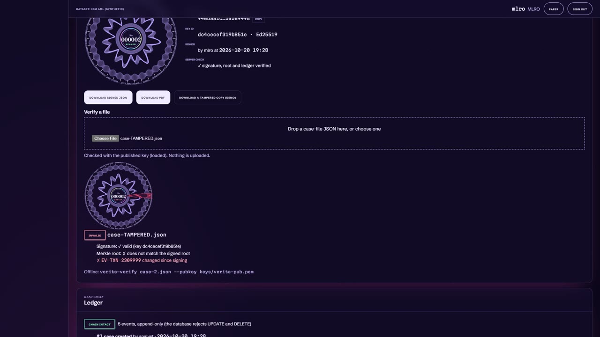</td>
<td width="50%" valign="top">

### 🖍️🕯️ A red pen, then a wax seal
An LLM drafts the report, but **never gets trusted**: every sentence must cite evidence, and a
**deterministic fact-checker** checks every amount, date and account against it — tested by
planting thousands of mistakes. A senior officer approves (**maker–checker**), and the case is
**sealed**: canonical JSON → Merkle tree → **Ed25519 signature**. Change one number and the seal
breaks *and names the exact item*. It even files as **goAML**, the format regulators already use.

</td>
</tr>
</table>

---

## 📊 Results

Every number below is generated by the evaluation pipeline (`uv run poe eval`) from
`reports/metrics.json`. Nothing here is typed by hand, and CI fails if it drifts.

<!-- metrics:start -->
> Generated by `verita report build` from `reports/metrics.json`. Do not edit by hand.

<table>
<tr>
<td align="center" width="25%"><h1>50.3%</h1><b>laundering F1</b><br><sub>vs 7.3% for a tuned bank-style rules engine</sub></td>
<td align="center" width="25%"><h1>98.4%</h1><b>recall delivered</b><br><sub>against a promised 95% guarantee</sub></td>
<td align="center" width="25%"><h1>99.96%</h1><b>planted LLM errors caught</b><br><sub>0.0% of clean narratives rejected</sub></td>
<td align="center" width="25%"><h1>47.8 ms</h1><b>p95 latency</b><br><sub>50 analysts working at once</sub></td>
</tr>
</table>

Synthetic data only: All results are on synthetic data (IBM AML, Altman et al. 2023). They do not establish performance on real bank data.

| Result | Value (95% CI) | Data |
|---|---|---|
| Laundering F1, champion | 50.3% (44.0%–59.1%) | IBM AML HI-Small (synthetic), test split, 1,797 laundering payments |
| Laundering F1, rules incumbent | 7.31% (6.34%–8.90%) | same |
| Published GFP + LightGBM (Altman et al. 2023, Table 2) | 62.86% ± 0.25 | same split definition |
| Realised recall at a 95% guarantee — static conformal | 98.4% (97.8%–98.8%) | 134,186 account-days reviewed |
| Realised recall at a 95% guarantee — adaptive (ACI) | 96.4% (95.6%–97.0%) | 120,457 account-days reviewed |
| Calibration error (ECE), before → after isotonic | 0.0116 → 0.0020 | test split |
| Planted narrative faults caught by the verifier | 99.96% (99.77%–99.99%) | 2,438 faults in 300 cases |
| Clean narratives wrongly rejected | 0.0% (0.0%–1.3%) | 300 cases |
| Robustness: laundering F1 on IBM AML LI-Small (synthetic) | 17.3% (13.5%–23.5%) | published GFP + XGBoost 27.30% |
| Latency p95, 50 analysts working (k6, through nginx) | 47.8 ms | 1,872 requests, 0.0% errors |

Where it is weak: bulk-day F1 is 38.5% (32.5%–44.5%); per-typology recall ranges from
29.1% (20.5%–39.4%) (RANDOM) to 66.8% (62.1%–71.3%) (GATHER-SCATTER);
the 95% recall guarantee would need 3,139 analysts on the busiest replay day. Full
report: [reports/EVAL_REPORT.md](reports/EVAL_REPORT.md) · [MODEL_CARD.md](MODEL_CARD.md).

<sub>metrics.json schema 1, built at commit `599a5bd7b396`.</sub>
<!-- metrics:end -->

---

## 🪙 Follow one payment

One real row from the data, followed all the way through — the same story the
[walkthrough film](https://drive.google.com/file/d/1R-3b8Q6HyusixPaMJe7pVZ4cET5YLe7i/view) tells.

| | Station | What happens to **$18,888.26 · ACH · 9 Sep 2022 16:01** |
|:---:|---|---|
| 1 | **Data** | One row of 5,078,345 — in the test period, so the model has never seen it. |
| 2 | **Features** | The receiver is 9 days old and got nothing last week; the sender just paid 8 new accounts at 8 banks in 3 days. |
| 3 | **Model** | Risk score **99.7%**, with four plain-English reasons. |
| 4 | **Pattern** | **Scatter-gather**, with the model's honest confidence attached. |
| 5 | **Guarantee** | Far above the scatter-gather review line → **must review**. |
| 6 | **Plan** | Locked into today's work plan before anything optional. |
| 7 | **Case** | 25 payments, 22 accounts, 17 banks, $164,466.93 — an LLM drafts, the fact-checker verifies every sentence. |
| 8 | **Sign** | MLRO approves; root `94ebaa1c…5e9498` signed with Ed25519; goAML report filed inside the signed tree. |

---

## 🏗️ How it works

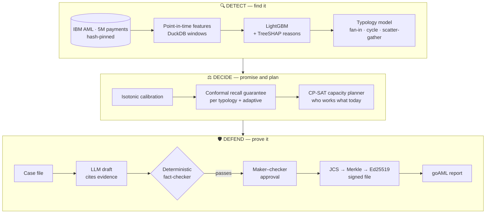

<details>
<summary><b>Under the hood — the engineering a reviewer will look for</b></summary>

<br>

| Area | What's there |
|---|---|
| **Leakage** | Time-ordered splits by transaction count; every rolling feature ends one minute before the payment, enforced by a property test; a label-shuffle test; a random-split comparison that shows how much a careless split would overstate. |
| **Evaluation** | Block-bootstrap confidence intervals, seed stability, feature-group ablations, per-typology results, a robustness run on a second dataset, and a published-baseline comparison. |
| **Governance** | Model lifecycle *candidate → approved → champion* behind written policy gates; validator ≠ promoter, **enforced by a database check constraint**. |
| **Security** | Four roles, CSRF-checked sessions, a test that walks every route × every role, hash-chained audit ledger, [threat model](docs/THREAT_MODEL.md). |
| **CI** | Lint, types, tests with a coverage gate, CodeQL, Bandit, pip-audit, Grype on the images, Lighthouse, browser end-to-end tests, a k6 load test, x86 **and** ARM image builds. |
| **Honesty** | Every metric in the docs is generated from one file; a scan fails CI on any hand-typed result. |

Decisions are written down: [8 architecture decision records](docs/adr) ·
[40 panel questions, answered with file and line](docs/DEFEND_IT.md) ·
[model card](MODEL_CARD.md) · [full evaluation report](reports/EVAL_REPORT.md) ·
[runbook](docs/RUNBOOK.md).

</details>

---

## 🖥️ Inside the app

<table>
<tr>
<td width="33%">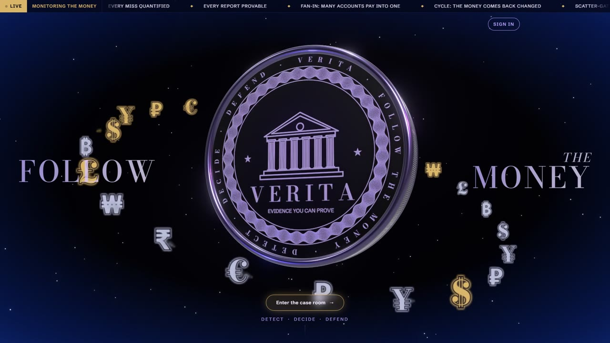<br><sub><b>The stage</b> — money performing laundering patterns</sub></td>
<td width="33%">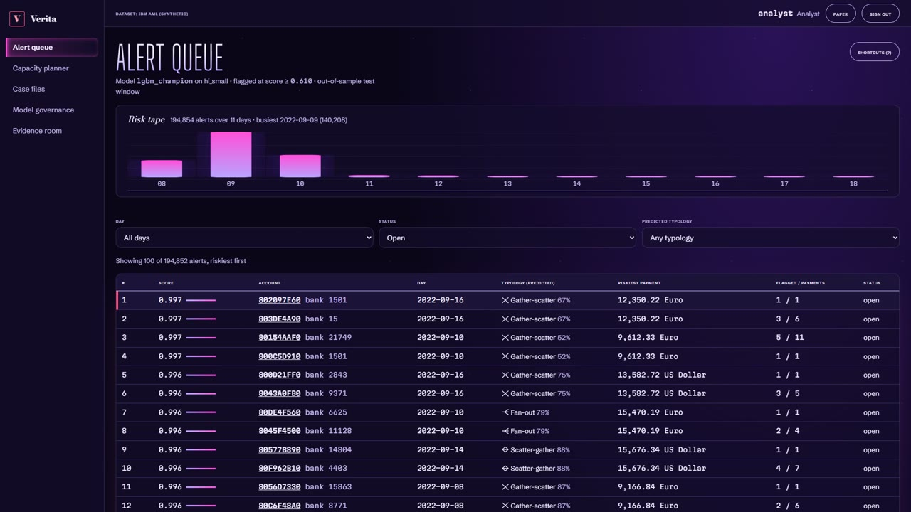<br><sub><b>The queue</b> — ranked alerts and the daily risk tape</sub></td>
<td width="33%">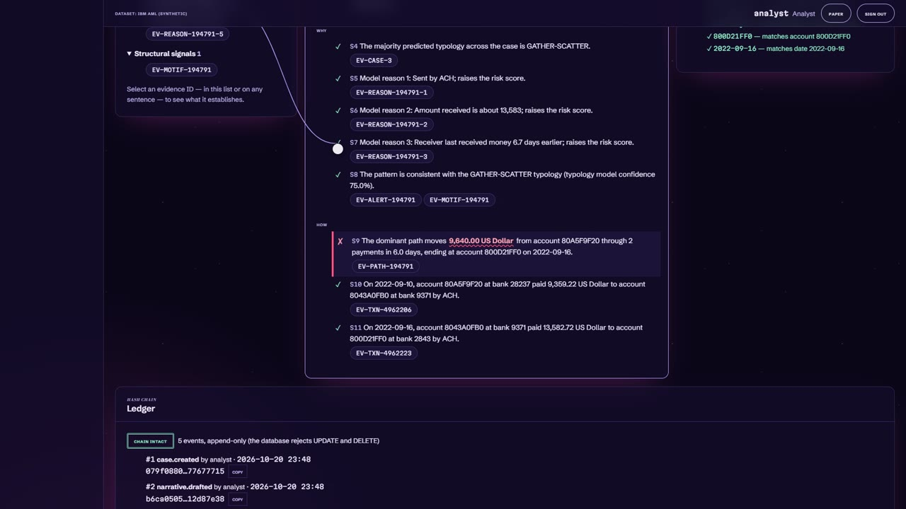<br><sub><b>The fact-checker</b> — a planted fault, caught</sub></td>
</tr>
<tr>
<td width="33%">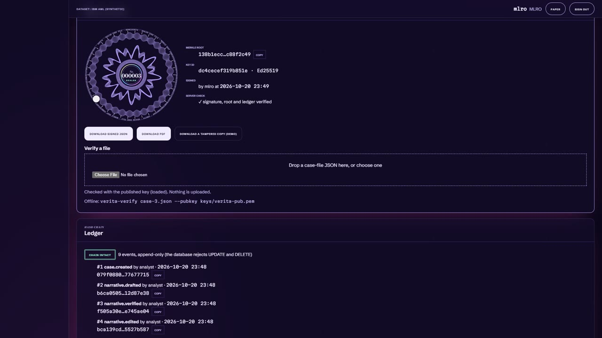<br><sub><b>The seal</b> — a signed case file and its ledger</sub></td>
<td width="33%">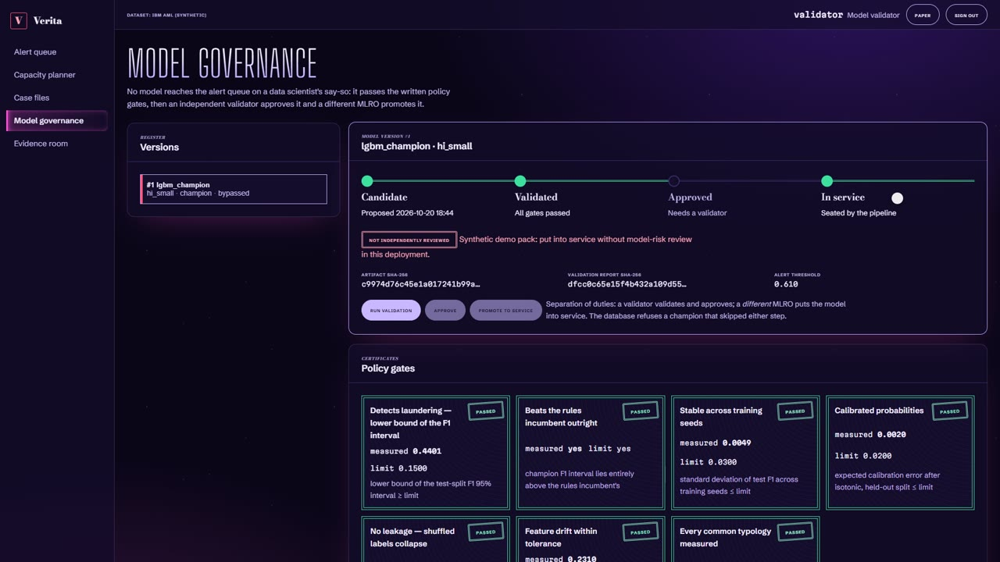<br><sub><b>Governance</b> — policy gates before any model ships</sub></td>
<td width="33%"><br><sub><b>The planner</b> — what the guarantee costs in people</sub></td>
</tr>
</table>

---

## 🚀 Run it

### One click on Windows

Double-click **`Start Verita.bat`**, or the "Verita" desktop shortcut that points at it. It:

1. checks for uv, Python 3.11 and Node.js LTS (installing any that are missing with `winget`)
   and installs the backend and web packages when they are missing or out of date;
2. migrates the database and creates the demo users, with the password from `VERITA_DEMO_PASSWORD`
   in `backend/.env` or a generated one saved to `.verita-demo-password`. If the HI-Small model
   isn't built, it builds the small fixture dataset instead (about 2 minutes) so the app still
   works;
3. starts the API (port 8000) and the web app (port 5173), each in its own minimised window,
   and waits until both answer;
4. opens <http://localhost:5173> in your most recently used browser, and shows the sign-in.

`stop-verita.ps1` stops both. A desktop shortcut with the Verita icon:

```powershell
$s = (New-Object -ComObject WScript.Shell).CreateShortcut("$env:USERPROFILE\Desktop\Verita.lnk")
$s.TargetPath = "$PWD\Start Verita.bat"; $s.WorkingDirectory = "$PWD"; $s.IconLocation = "$PWD\assets\verita.ico"; $s.Save()
```

### By hand

Requirements: Python 3.11, [uv](https://docs.astral.sh/uv/), Node 20.

```bash
cd backend
uv sync --extra dev
uv run poe migrate
uv run verita users seed-demo
uv run poe serve
```

```bash
cd frontend
npm ci
npm run dev
```

### The full stack

PostgreSQL, API, job worker and nginx on one origin, after building a demo pack:

```bash
docker compose -f deploy/docker-compose.yml up --build -d
docker compose -f deploy/docker-compose.yml run --rm api verita users seed-demo
```

Then open <http://localhost:8080>. Guided tour: [docs/DEMO_SCRIPT.md](docs/DEMO_SCRIPT.md) ·
operating it: [docs/RUNBOOK.md](docs/RUNBOOK.md).

---

## ⚖️ Honest limits

- **Synthetic data.** Trained and evaluated on IBM's synthetic AML data (Altman et al., 2023): this
  proves the *method* is sound and reproducible, not performance on a real bank's customers.
- **Below the best published model** on the same split — and the results table says so.
- **The fact-checker checks facts, not reasoning.** It matches values to evidence; whether the
  story makes sense is still a human MLRO's call, which is why a human approves every case.
- **Demo key management.** The signing key lives on disk; in a bank it belongs in an HSM or KMS.

---

<details>
<summary><b>Repository layout</b></summary>

| Path | Contents |
|------|----------|
| `backend/` | FastAPI app, pipeline, models, verifier, signing |
| `frontend/` | React + TypeScript app |
| `configs/` | Data manifest, operational assumptions, model config |
| `docs/adr/` | Architecture decision records |
| `deploy/` | Docker Compose, monitoring config, production overrides (`deploy/prod/`) |
| `perf/` | k6 load test and its recorded results |
| `reports/` | Generated metrics, eval report, security scans and SBOMs |

</details>

<div align="center">

**Built end to end by [Raj Modi](https://linkedin.com/in/rajmodi2004)** — data pipeline, models, optimisation, cryptography, platform and interface.

MIT licensed — see [LICENSE](LICENSE).

<sub>Detect · Decide · Defend</sub>

</div>
